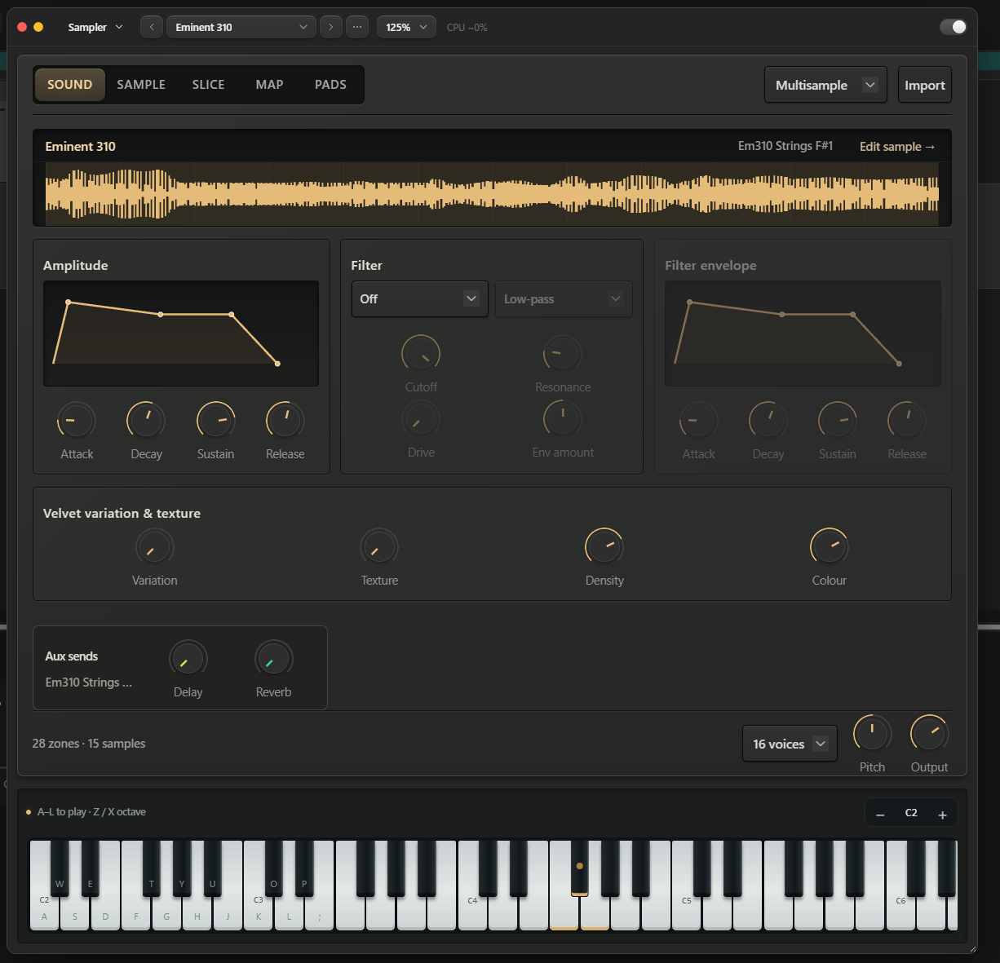
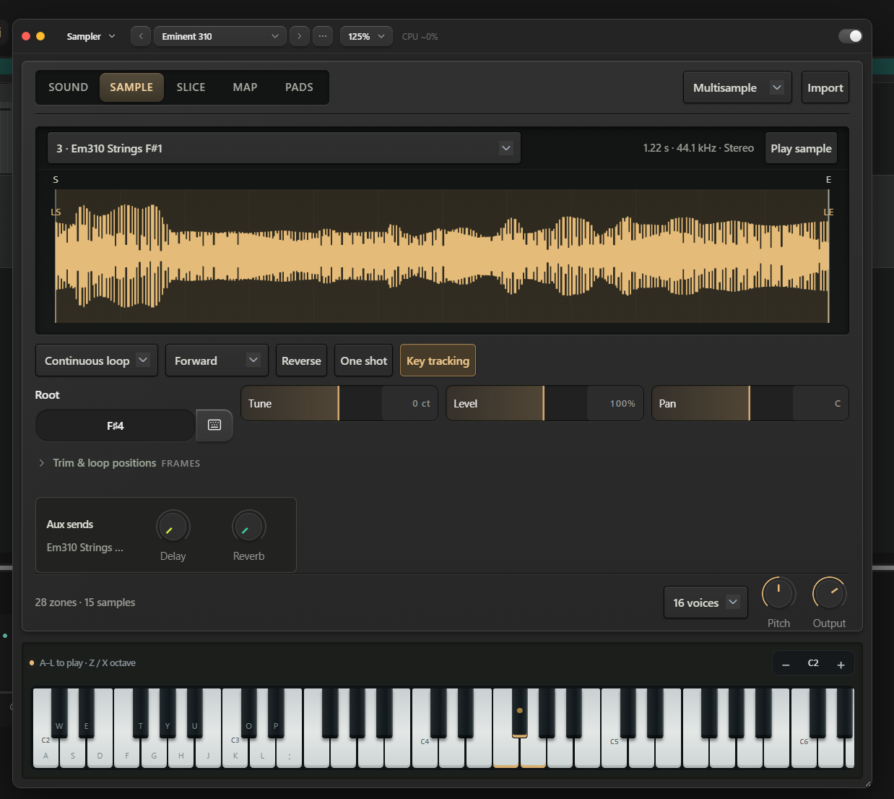
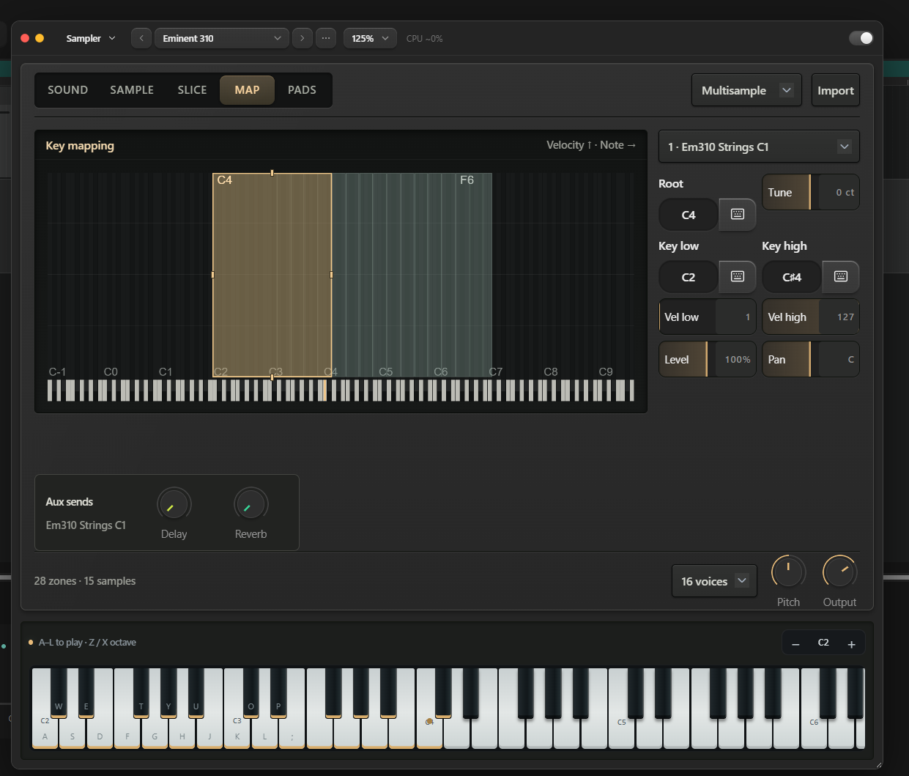
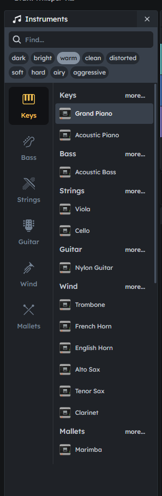

# Inspiratie: sampler-editor en patchkiezer (2026-10-11)

Schermafbeeldingen die Mark aandroeg als inspiratie, met wat eraan opvalt en
waar het bij MusicBrain op aansluit. Geen besluit en geen ontwerp: een
voorraad ideeën voor het [editorstructuurplan](editor-structuur.md), vooral
§3.1 (één patchkiezer) en §5 (editor bij een moduletype). Waar ze vandaan
komen staat er niet bij; de vensterstijl is die van de DAW van synthcity
(daw.synthcity.org), dezelfde als hun "Speak"-plugin.

## Sampler

Eén sampler met vijf weergaven bovenin: **SOUND · SAMPLE · SLICE · MAP ·
PADS**, en rechts een keuze voor de soort (Multisample) en **Import**.
Onderaan steeds hetzelfde: aantal zones en samples, stemmen, Pitch, Output.

### SOUND: de klank van het hele instrument

- Bovenin de golfvorm van het sample dat nu klinkt, met **Edit sample →**.
- **Amplitude** als grafiek met sleepbare punten (ADSR), met de vier knoppen
  eronder: je ziet wat Attack en Release doen.
- **Filter** met een typekeuze; op **Off** worden Cutoff, Resonance, Drive en
  de hele **Filter envelope** grijs. Wat niet meedoet valt weg, maar blijft
  zichtbaar.
- **Variation & texture** (Variation, Texture, Density, Colour): per noot iets
  variëren, zodat een herhaalde noot niet als een machinegeweer klinkt.
- **Aux sends** (Delay, Reverb) per instrument.

### SAMPLE: één sample

- Keuze van het sample, met lengte, samplefrequentie en kanalen, en **Play
  sample**.
- Golfvorm met markeringen **S/E** (start, eind) en **LS/LE** (lus).
- Lusstand (Continuous loop), richting (Forward), **Reverse**, **One shot**,
  **Key tracking** als knoppen naast elkaar.
- **Root** met een **toetsenbordknop**: de noot inspelen in plaats van typen.
- Tune, Level en Pan als horizontale balken met de waarde erin.
- "Trim & loop positions" ingeklapt voor wie het precies wil.

### MAP: de zones

- Een raster met **velocity omhoog en noot naar rechts**; elke zone is een
  blok met sleepbare randen; de gekozen zone licht op.
- Rechts de zone: Root, **Key low** en **Key high** (elk met een
  toetsenbordknop), Vel low/high, Level, Pan.
- Het klavier onderaan licht de toetsen van de zone op.

## Patchkiezer

- Links **categorieën met een pictogram** (Keys, Bass, Strings, Guitar, Wind,
  Mallets); rechts per categorie een paar patches en **more…**.
- Bovenin een **zoekveld** en **karakterlabels** als chips: dark, bright,
  warm, clean, distorted, soft, hard, airy, aggressive.

## Waar het bij ons aansluit

| Idee | Bij ons nu | Aansluiting |
|---|---|---|
| Eén sampler met weergaven | 🎹 Multisample-import (`SampleImportModal.tsx`), `SampleModal.tsx`, de bankbalk (`sim/SamplerBankBar.tsx`) en de Bank-knop zijn losse plekken | editor-structuur §5 (editor bij een moduletype) |
| MAP als raster | zones bestaan al (`WasmZone`: key- en velocityzones, root, tune, gain, pan, loop) maar zijn niet als beeld te bewerken | idem |
| Envelope als grafiek | envelopes zijn knoppen | ook bruikbaar voor ENV-modules en de CMI-stem |
| Grijs wat niet meedoet | `disabledControlIds` in `ModulePanel` bestaat (bv. `steal` in mono) | uitbreiden naar "Filter Off → filterknoppen grijs" |
| Toetsenbordknop bij een noot | noten worden getypt of gekozen | het schermtoetsenbord (`FrontKeys`) of MIDI-in als invoer |
| Variation & texture | — | idee voor de sampler-kern (round robin, kleine afwijkingen per noot) |
| Patchkiezer met categorieën en labels | `PatchSelect`, `patchCatalog.ts`; labels bestaan in de patch-pool | editor-structuur §3.1 (één patchkiezer, "Meer…" op volledig scherm, besloten 2026-10-10) |
